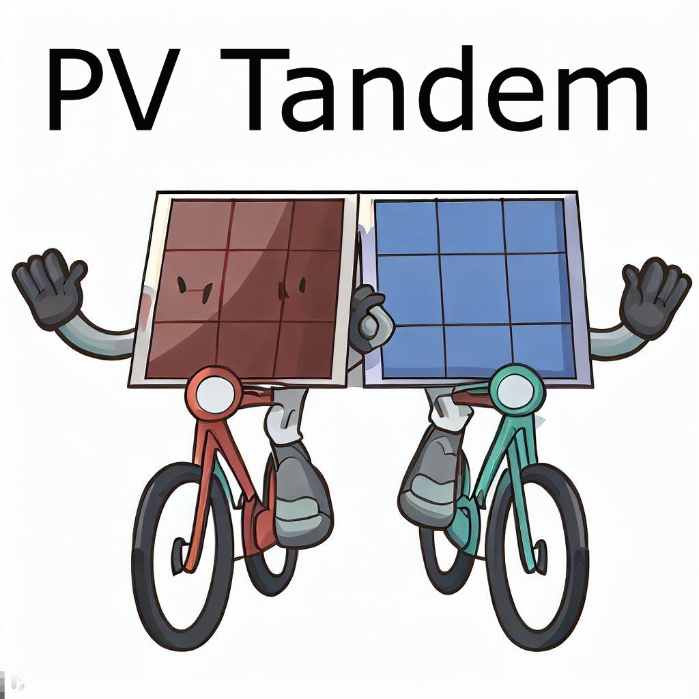

.. image:: https://img.shields.io/pypi/v/pv_tandem.svg
        :target: https://pypi.python.org/pypi/pv_tandem

.. image:: https://img.shields.io/github/actions/workflow/status/nano-sippe/pv_tandem/pytest.yml
        :target: https://github.com/nano-sippe/pv_tandem/actions/workflows/pytest.yml/badge.svg

.. image:: https://readthedocs.org/projects/pv-tandem/badge/?version=latest
        :target: https://pv-tandem.readthedocs.io/en/latest/?version=latest
        :alt: Documentation Status

pv_tandem is a python toolbox for simulation and energy yield calculations of single junction and tandem solar cells with classical (monofacial) or bifacial illumination.

* Free software: MIT license
* Documentation: https://pv-tandem.readthedocs.io.

Features
--------

* Helping tools to process irradiance data for solar cell simulations
* Electrical modeling with 1-diode model for single junction or tandem solar cells
* Modeling of illumination in a large PV power plant for the front- and backside of the modules
* Thermal modeling of module and cell temperatures, and energy yield calculations for PV modules with and without sub-bandgap reflectors

Thermal module
--------------

The module ``thermal.py`` calculates module and cell temperatures and the
resulting energy yield. The folder ``examples/thermal`` contains examples and
Jupyter notebooks for the results of "How do sub-bandgap reflectors affect the
performance of photovoltaic modules?" (arXiv:2604.20757):

* ``example_01_sbr_princeton_non_spectral.py`` and
  ``example_02_sbr_princeton_spectral.py``: scripts that calculate the annual
  energy yield of a PV module with and without a sub-bandgap reflector, using
  NSRDB data without and with spectral irradiance, respectively.
* ``notebook_01_energy_yield.ipynb``: recreates Figs. 3 and 5 of the
  manuscript.
* ``notebook_02_degradation.ipynb``: calculations on degradation, recreates
  Figs. 6 and 7 of the manuscript.

Figure numbers refer to version 2 of the arXiv preprint. The input data are
described in the README in ``examples/thermal/data_thermal``.

All of these examples and notebooks, and the results in the manuscript, were
produced with Python 3.11, numpy 2.4.6, pandas 3.0.3, scipy 1.17.1,
pvlib 0.15.0 and matplotlib 3.11.0. The same versions are listed in
``environment.yml`` (conda) and ``requirements.txt`` (pip). To recreate the
environment, run in the top folder of the repository either
``conda env create -f environment.yml``, or
``pip install -r requirements.txt`` followed by ``pip install .``. Jupyter is
needed for the notebooks and is included in both files.

Where to get it
---------------

The basic functionality of pv_tandem (without the thermal module) can easily be
installed from PyPI with pip:

.. code-block:: bash

    pip install pv_tandem

The thermal module (``thermal.py``, version 0.2.0 and later) is not available
on PyPI. To use it, download this repository (from GitHub, or as the archived
version on Zenodo) and install it from the downloaded folder:

.. code-block:: bash

    pip install .

The examples and Jupyter notebooks for the thermal module are in
``examples/thermal``. The section "Thermal module" gives the environment used
for the results in the manuscript.

For more installation options see the `getting started <https://pv-tandem.readthedocs.io/en/latest/usage.html>`_ section of the documentation. See the `example gallery <https://pv-tandem.readthedocs.io/en/latest/auto_examples/index.html>`_ to see several use cases of pv_tandem.
